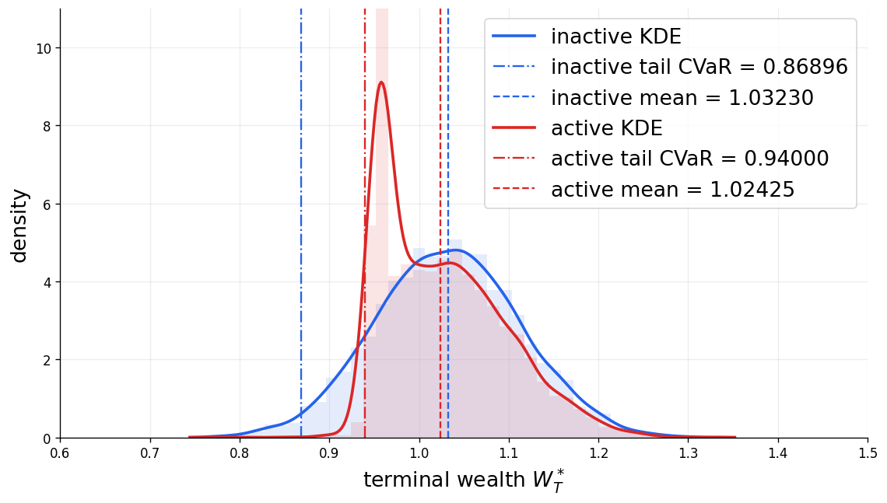
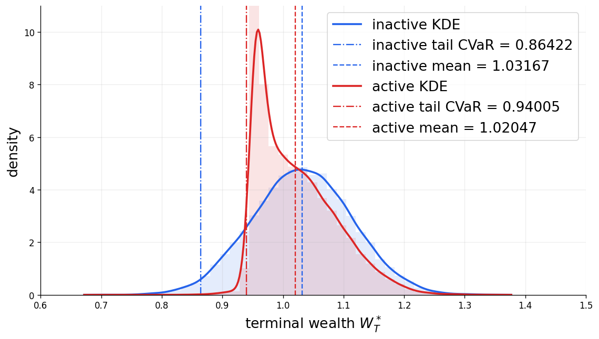
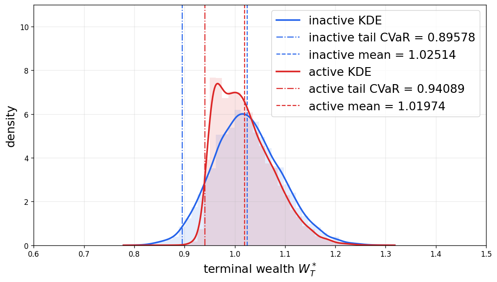
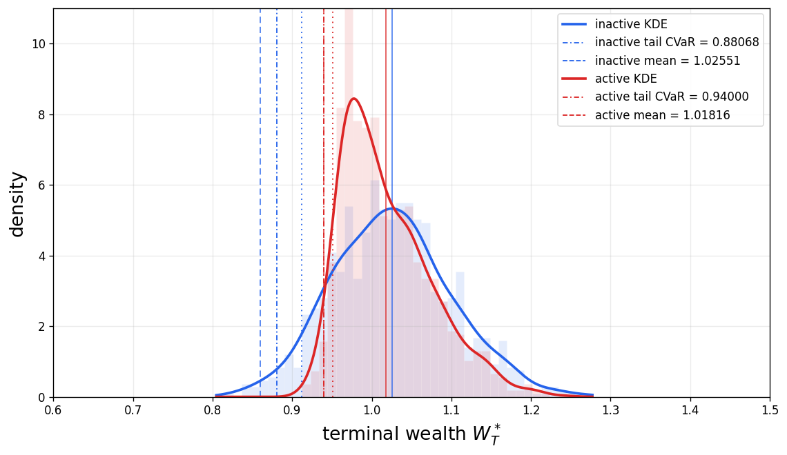

# Dynamic Portfolio Optimization under CVaR Constraints

Four standalone Python scripts reproduce the complete-market, incomplete-market,
quadratic trading-rate regularization, and square-root price-impact experiments.
Each script contains its own solver, parameter search, simulation, and plotting
code and computes both the nonbinding calibration (`c = -0.86`) and the binding
calibration (`c = -0.94`) from scratch.

## Model and notation

Terminal loss is

$$
L_T=-W_T,
$$

and the risk constraint is

$$
\mathrm{CVaR}_{\alpha}(L_T)\le c,
\qquad \alpha=0.95.
$$

The labels **nonbinding** and **binding** refer to the calibration cases
$c=-0.86$ and $c=-0.94$, respectively. Result dictionaries and CSV files retain
the internal keys `inactive` and `active`.

The empirical feasibility residual is

$$
\widehat{\mathrm{CVaR}}_{\alpha}(-W_T)-c.
$$

A nonpositive residual means that the estimated CVaR satisfies the budget on the
evaluation sample. A positive residual indicates an empirical budget exceedance.
These labels do not guarantee that a separately evaluated policy will satisfy
the budget on every simulation sample.

### Direct-exposure benchmarks

In the complete- and incomplete-market experiments, $\varphi_t$ denotes dollar
risky exposure and

$$
dW_t
=\varphi_t(\mu\,dt+\sigma\,dB_t)
+\beta^{\perp}dB_t^{\perp}.
$$

The complete-market case sets $\beta^{\perp}=0$; the incomplete-market case sets
$\beta^{\perp}=0.02$, with $B^{\perp}$ independent of $B$. The objective is

$$
J(\varphi)
=\mathbb E\Big[
\int_0^T
\frac{\gamma}{2}\left((\sigma\varphi_t)^2+(\beta^{\perp})^2\right)
-\mu\varphi_t
dt
\Big].
$$

The unconstrained Merton dollar exposure is
$\bar\varphi=\mu/(\gamma\sigma^2)=0.40$. It is a benchmark, **not an additional
exposure cap**. The numerical exposure bounds remain $[-2.00,2.00]$.

The complete- and incomplete-market experiments now use the same direct-exposure
search protocol: the same time discretization, wealth-grid resolution,
threshold and multiplier tolerances, and independent multiplier-selection
sample. This makes the complete-market benchmark directly comparable with the
$\beta^{\perp}=0$ endpoint of the incomplete-market comparative statics.

### Trading-rate regularization and square-root price impact

Let $\phi_t$ denote the number of shares and define

$$
\varphi_t=\phi_tS_t,
\qquad
\dot\varphi_t=\dot\phi_tS_t.
$$

Here, $\dot\varphi_t$ denotes the signed dollar trading-rate control; it is not
the ordinary time derivative of the diffusion $\varphi_t$. The exposure state
evolves as

$$
d\varphi_t
=\dot\varphi_t\,dt
+\varphi_t(\mu\,dt+\sigma\,dB_t),
\qquad \varphi_0=0.
$$

The two specifications have different economic interpretations:

- **Quadratic regularization:** $\Lambda\dot\varphi_t^2/2$, with
  $\Lambda=0.01$, penalizes trading in the objective and smooths portfolio
  adjustment. It is not deducted from wealth.
- **Square-root price impact:** execution cost is
  $\Lambda_{3/2}|\dot\varphi_t|^{3/2}/(3/2)$, with
  $\Lambda_{3/2}=0.004472135955$. This cost enters the objective and is also
  deducted from wealth through the execution-price adjustment.

## Calibration and independent evaluation

Policy selection and final evaluation use separate simulation samples:

1. For each candidate multiplier, the HJB feedback policy and Rockafellar--Uryasev
   threshold are computed from the training sample.
2. In both direct-exposure experiments, 20,000 independent paths are used to
   select the raw dual root through the CVaR residual. These paths are part of
   calibration, not final evaluation.
3. The selected multiplier, threshold, and feedback policy are frozen.
4. The frozen policy is evaluated on 50,000 independent out-of-sample (OOS)
   paths for the reported summary statistics and distributional figures.

No safety buffer, feasibility adjustment, or parameter retuning is applied using
the final OOS sample. Empirical OOS exceedances are reported unchanged.

| Experiment | Search paths | Additional multiplier-selection paths | Final OOS paths | Final OOS seed |
| --- | ---: | ---: | ---: | ---: |
| Complete market | 5,000 | 20,000; seed `686035552` | 50,000 | `1900013` |
| Incomplete market | 5,000 | 20,000; seed `686035552` | 50,000 | `1900013` |
| Quadratic regularization | 10,000 | None | 50,000 | `1900013` |
| Square-root impact | 1,000 | None | 50,000 | `900013` |

### Numerical resolution

The following are the effective settings used by the current solvers.

| Experiment | Time steps | HJB state grid | Control domain and minimization | $\eta$ tolerance | $\lambda$ tolerance | CVaR residual tolerance | Maximum $\eta/\lambda$ iterations |
| --- | ---: | --- | --- | ---: | ---: | ---: | --- |
| Complete market | 100 | 201 nonuniform points in $W$, concentrated near $W=-\eta$ | Dollar exposure in $[-2.00,2.00]$; analytic quadratic minimization with boundary checks; no Merton cap | $5\times10^{-4}$ | $10^{-6}$ | $10^{-5}$ | 40 / 20 |
| Incomplete market | 100 | 201 nonuniform points in $W$, concentrated near $W=-\eta$ | Dollar exposure in $[-2.00,2.00]$; analytic quadratic minimization with boundary checks; no Merton cap | $5\times10^{-4}$ | $10^{-6}$ | $10^{-5}$ | 40 / 20 |
| Quadratic regularization | 320 | $161\times193$ in $(W,\varphi)$ | Trading rate in $[-2.00,2.00]$; bounded quadratic minimization | $5\times10^{-4}$ | $10^{-4}$ | $10^{-4}$ | Tolerance-based / 12 |
| Square-root impact | 200 | $80\times100$ in $(W,\varphi)$ | Trading rate in $[-4.00,4.00]$; analytic Hamiltonian minimization with boundary checks | $10^{-5}$ | $10^{-7}$ | $10^{-6}$ | 32 / 32 |

For the direct-exposure experiments, the wealth range is initialized from pilot
simulations and, for positive multipliers, the 201-point grid is concentrated
near the terminal CVaR kink $W=-\eta$. The grid is rebuilt as the candidate
threshold changes. The trading-rate models use wealth and dollar risky exposure
as the two HJB states and retain exposure-state bounds of $[-2.00,2.00]$.

The square-root-impact script retains legacy action-grid settings, but its
current HJB solver minimizes the trading-rate Hamiltonian analytically rather
than restricting the policy to those candidate rates. Its effective threshold
search tolerance and iteration limit are $10^{-5}$ and 32, respectively.

Numba acceleration is embedded in the scripts and uses the same
finite-difference formulas and numerical settings as the corresponding NumPy
implementations.

## Common calibration

| Parameter | Symbol | Value |
| --- | --- | ---: |
| Horizon | $T$ | 1 |
| Initial wealth | $W_0$ | 1.00 |
| Risk-free rate | $r$ | 0.00 |
| Risky-asset drift | $\mu$ | 0.08 |
| Risky-asset volatility | $\sigma$ | 0.20 |
| Risk aversion | $\gamma$ | 5 |
| CVaR confidence level | $\alpha$ | 0.95 |
| Nonbinding CVaR limit | $c$ | -0.86 |
| Binding CVaR limit | $c$ | -0.94 |
| Merton dollar exposure | $\mu/(\gamma\sigma^2)$ | 0.40 |

## Reference out-of-sample results

The following estimates use the frozen policies and independent OOS samples.
Financial summary statistics are displayed to two decimal places. Residuals are
computed from unrounded estimates and shown in scientific notation so that small
budget exceedances remain visible.

| Experiment | Case | $c$ | $\widehat\lambda$ | Loss CVaR | $\mathbb E[W_T]$ | Average exposure | OOS residual |
| --- | --- | ---: | ---: | ---: | ---: | ---: | ---: |
| Complete market | Nonbinding | -0.86 | 0.00 | -0.87 | 1.03 | 0.40 | `-7.06e-03` |
| Complete market | Binding | -0.94 | 0.05 | -0.94 | 1.02 | 0.31 | `+8.22e-04` |
| Incomplete market | Nonbinding | -0.86 | 0.00 | -0.86 | 1.03 | 0.40 | `-1.97e-03` |
| Incomplete market | Binding | -0.94 | 0.13 | -0.94 | 1.02 | 0.26 | `+1.75e-03` |
| Quadratic regularization | Nonbinding | -0.86 | 0.00 | -0.90 | 1.02 | 0.31 | `-3.71e-02` |
| Quadratic regularization | Binding | -0.94 | 0.05 | -0.94 | 1.02 | 0.24 | `-4.26e-04` |
| Square-root impact | Nonbinding | -0.86 | 0.00 | -0.88 | 1.03 | 0.35 | `-2.39e-02` |
| Square-root impact | Binding | -0.94 | 0.08 | -0.94 | 1.02 | 0.24 | `-8.84e-04` |

For the binding complete-market case, the selected raw multiplier is
$\widehat\lambda=0.05474853515625$. On the independent 50,000-path OOS sample,
the corresponding loss CVaR is $-0.9391784414$, the average risky exposure is
$0.3061333656$, and the empirical residual is $8.22\times10^{-4}$. These OOS
quantities are reported without retuning the multiplier.

Full-precision values, including the threshold estimates, are available in
[`reference_results.csv`](reference_results.csv). Reference values are used for
comparison and are not supplied to the optimization algorithms.

In the direct-exposure experiments, average exposure is the average of the
dollar-exposure control over simulation paths and decision dates. In the
trading-rate experiments, it is the average of the exposure state over paths
and stored dates. The reported CVaR and wealth means are Monte Carlo estimates;
different seeds produce sampling variation.

### Figure conventions

Figure legends, numeric annotations, axes, and colorbars display decimal values
to two places. Rounding affects display only; calculations, saved policies, and
CSV results retain their original precision.

Exposure bands show the 10th--90th percentiles across simulated paths and are
not confidence intervals for the mean. Selected favorable and unfavorable
paths illustrate feedback behavior. The incomplete-market experiment also
includes a full policy map and the path with the lowest terminal wealth in the
evaluation sample. The latter is an explicitly selected extreme realization.
These diagnostics show that exposure can exceed the Merton benchmark in
sufficiently low-wealth states, even when average exposure is below it.

Interim CVaR curves report unconditional loss CVaR over time. The optimization
imposes the risk constraint only at maturity; those curves are descriptive
diagnostics of the computed policy.

## Stored figures

These overview images show the current reference figures. Running the scripts
generates the individual PNG and vector PDF files in `results/<model>/figures/`.

  
  

  
  

